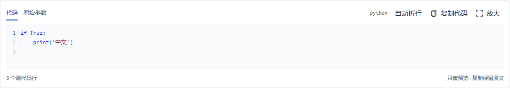
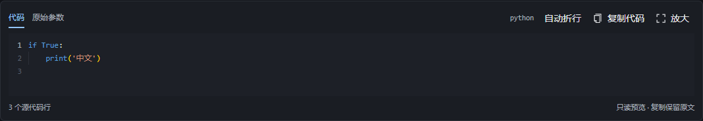

# 只读代码预览

智能问答的 `run_code` 调用卡片和 Trace 输入详情支持只读代码预览。预览复用现有编辑器和主题，不执行代码。

## 查看与复制

- “代码”显示语法高亮和源行号；“原始参数”显示完整参数，包括代码以外的字段。
- “自动折行”只改变长行的视觉布局，不增加源码换行或改变缩进。
- “复制代码”复制传入组件的原始代码；“复制参数”复制原始参数视图中的完整文本。
- “放大”打开较大的查看窗口；按 Esc 关闭后焦点返回原按钮。
- 可以用左右方向键切换页签，用 Home、End 移到首尾页签。

代码可能是 AI 生成的长单行，也可能含错误语法、缺失缩进或 Markdown 围栏。预览保留这些内容，便于检查实际输入，不猜测修复。

参数容器中的 JSON 转义由正常 JSON 解析处理一次；代码字符串本身不再反转义。代码里的字面量反斜杠 n、Windows 路径与真正换行保持区别。系统剪贴板可能规范化文本换行，应用复制逻辑直接使用原文。

## 回退规则

- 缺失代码、非文本代码或无效参数保持原有参数展示；空字符串显示空态。
- 历史 JSON 字符串参数最多解析一层，不反复解码多重编码的输入。
- 未知语言使用纯文本模式；编辑器加载失败时仍可阅读和复制原文。
- 超过 200,000 个 UTF-16 代码单元的代码完整回退纯文本，不截断。该阈值只控制预览方式，不表示后端执行配额。
- Trace 引用载荷仍需用户主动加载；输出载荷保持原有展示，不按输入代码识别。

## 模块边界

`framework/code-preview` 只负责代码参数提取和展示；`knowledge-network` 与 `bkn-trace` 各自判断工具名称并接入。请求组装、后端执行、权限和错误处理继续由原有模块负责。

JavaScript/TypeScript 使用对应 Monaco 后台线程，JSON 使用 JSON 线程，Python 等语言使用通用编辑器线程。预览关闭时释放编辑器模型和监听器。

## 界面示例

以下截图使用正式共享组件、项目主题及合成代码样例，不包含业务数据。

